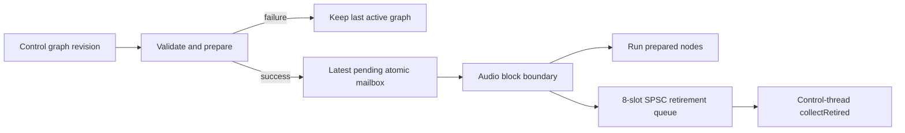

# Basic realtime audio engine

## Scope and boundaries

`VisualAudioLab.Audio` is a standard C++20 library depending on Application/Domain and the device-independent Script target. It implements `AudioEngine`, `AudioGraph`, Input/Output, the [DSP module framework](DspModules.md) and verified [VAL Script](ValScript.md) kernels. `AudioProcessorNode` is now an alias of the unified `AudioNode` base; Gain has not been duplicated. Infrastructure implements the Application-owned stream boundary through JUCE. The engine includes no device or UI headers, plugins, mixer, resampler or parallel scheduler. Runtime parameter scheduling is implemented; editable/persisted automation lanes are not.

The desktop composes the engine and backend through [occasional Audio Setup and explicit transport](DesktopWorkflow.md). Nothing opens or starts audio on startup/load. The user selects endpoints/configuration and starts transport; valid edits can then publish new prepared graphs. Load/patch switch stops transport. Hardware playback is not an implicit side effect of persistence.

## Minimal graph semantics

- Float32 planar PCM, one bus with 1-32 channels. Input and output widths match; output-only sessions may explicitly select zero device inputs, in which case Input produces silence. No automatic channel expansion, truncation or device fallback.
- Input copies corresponding device input channels into prepared scratch. Null/missing input pointers produce silence; preallocated input staging permits input/output pointer aliasing.
- Gain multiplies samples by a finite linear factor in `[0,4]` (default 1). Live gain messages ramp to the target over five milliseconds, independent of block partitioning. The initial/prepared value applies immediately. There is no implicit limiter; callers must control output levels before enabling live input routing.
- Output copies one upstream bus to the corresponding device output channels. Outputs are cleared before execution, so an empty graph or disconnected Output produces silence.
- Every nonempty graph has exactly one Output. Each input has at most one source; Input cannot receive wires and Output cannot send them. Missing references, cycles, duplicate/zero identities and disconnected/dead branches fail preparation. With the current single-input processors and no mixer, useful connected graphs are Input followed by effect/analyzer nodes and Output. Generic graph fan-out cannot produce multiple live branches without a future explicitly designed sink/mixer; it is not implicitly summed.
- An unconnected Gain reads the prepared silent bus. Empty graphs are valid silence. Invalid new graphs leave the last valid graph active and return an error.
- This runtime is limited to 256 nodes/connections, 8-384 kHz, a nominal buffer size within a declared capacity of 1-4096 frames, at most 64 MiB scratch and 128 MiB combined scratch/processor buffers per prepared plan. Input staging is additional (at most 512 KiB), as are bounded object/queue overheads. These are explicit engineering bounds, not a claim that the largest graph meets every hardware deadline.

`AudioGraph::fromStructural()` explicitly maps persisted generic nodes through scalar parameters:

| Parameter | Meaning |
|---|---|
| `audio.type` | Exact string `Input`, `Output`, `Gain`, `EQ`, `Delay`, `Compressor`, `Distortion`, `Chorus`, `Reverb`, `Analyzer` or `Script`; mandatory for each mapped node. |
| `audio.script` | Source string required on Script; compiled off-callback by the explicit structural mapper. |
| `audio.gain` | Optional finite double in `[0,4]`, only on Gain. |
| `audio.param.<name>` | Optional finite scalar from the processor's documented parameter domains; cannot duplicate `audio.gain`. |
| `audio.bypass` | Optional boolean for effects/analyzers/Script (dry for effects, silence for sources), not routing Input/Output. |

Stable node IDs and directed connections are preserved; display names and positions do not affect processing. Ordinary generic editor nodes are **not** silently converted into processors. `fromStructural` maps data; `prepare` still validates the complete graph/configuration. Unknown processor types/parameters are rejected. The desktop catalog supplies explicit metadata and its inspector edits saved targets. Existing persistence retains these scalar fields without a schema change.

Live parameter changes affect runtime state only, not project data/history. A caller that wants persistence must separately make an undoable workspace parameter edit and submit the corresponding runtime change. Graph replacement resets processor state to its supplied prepared values; it does not promise click-free topology changes or DSP-state migration.

Optional `AudioNodeDefinition::capture` taps copy complete prepared node outputs after all
automation subspans, with epoch/revision/sample-position provenance. There is no implicit
analyzer activation or pruned-branch processing. Ownership follows ordinary prepared-plan
retirement; capture performs only bounded preallocated copies/publication. FFT, RMS, peaks
and visualization run on the shared worker described in [SignalVisualization.md](SignalVisualization.md).

## Preparation, publication and reclamation

All control calls, preparation, allocation and destruction belong to the engine's creating thread. Backend operations additionally require JUCE's message thread. The backend must outlive the engine through `stop()`. A backend may be shut down first (which quiesces its callbacks), but its object must remain alive until engine cleanup finishes.

Preparation validates IDs, graph/channel rules and memory bounds, topologically orders the graph, constructs node instances and allocates/touches scratch. No graph traversal, validation, allocation or destruction is deferred to the callback.



Only one control producer and one serial render consumer are supported. Newer revisions must increase within a session. The producer publishes a fully prepared raw plan through a single atomic exchange. Superseded *pending* plans return to control ownership and are deleted there. The callback swaps at most one pending plan at a block boundary and returns the previous active plan through an eight-slot SPSC queue. If retirement is full, activation waits; it does not wait/spin, leak ownership or delete on the callback. `collectRetired()` reclaims acknowledged plans on the control thread; `publish()` also collects. Up to eight retired plans plus active/pending plans may temporarily coexist.

The 32-slot live parameter and 128-slot scheduled SPSC queues carry revision-scoped, prevalidated indices/values, not pointers into editable graphs. Work is bounded to the admission snapshot (at most 160 events) per nonempty callback. Messages for an older revision are cancelled and counted; future-revision messages wait for activation and scheduled messages delivered after their frame are missed rather than replayed. Queue saturation returns an explicit control error. Both queues merge by frame/acceptance sequence; see [DspModules.md](DspModules.md) for epoch, precedence, horizon and exact in-block timing. Reconfiguration and stop never depend on successfully enqueueing an ordinary parameter/graph message.

Callback atomics for plan pointers, queue indices, flags, stop reasons and 64-bit counters have `is_always_lock_free` compile-time assertions. The callback contains no mutex, logging, UI dispatch, ownership decrement, heap allocation/free or retry-until-success loop. Node/frame/channel work is bounded by the prepared limits. This qualifies the application renderer's implementation, not every internal JUCE/vendor/OS operation, and does not constitute a hard real-time OS guarantee.

The callback uses a monotonic nanosecond clock (`steady_clock` in production). Clock injection is only a deterministic test seam; an injected clock must itself be realtime-safe. Timing calls and atomics still require qualification on each deployed architecture.

## Stream lifecycle and faults

`IAudioBackend` now exposes explicit `openStream`, `startStream`, `stopStream`, `closeStream` and `streamDiagnostics` methods using standard Application values and a borrowed `IAudioRenderCallback`.

1. Enumerate and select current tokens for input/output. Specify rate, desired buffer frames, maximum callback frames and channel counts; no default stream is opened implicitly.
2. `AudioEngine::start()` opens the native stream **without** an application render callback, receives actual negotiated format and prepares a graph for it.
3. If graph preparation fails, the opened device is closed. Only after preparation succeeds does explicit start attach the render target. Start failure stops/closes and reclaims the prepared graph.
4. Changes publish complete plans or bounded gain messages. A rate/layout/capacity change requires explicit stop/reprepare/restart, not callback allocation or conversion.
5. `stop()` first disables rendering, then stops/quiesces callbacks and closes the device before reclaiming plans/nodes. Native shutdown follows the same order. No native handle or borrowed callback target outlives quiescence.

Native open validates channel availability and exact rate/layout. The driver may negotiate a different nominal period if it remains within the explicitly declared capacity; the actual period is returned. Unsupported negotiation fails instead of silently resampling/truncating. ASIO input/output must select the same driver. Capability probing is rejected while a stream is open, avoiding a second temporary driver initialization.

The native adapter silences when no render target exists or a native fault is latched. Native error/stopped callbacks only set lock-free flags and notify the renderer through its atomic-only interruption method; they do not allocate error strings, log or dispatch UI. Native list invalidation closes a running/opened stream on the control thread. Conservative ASIO PnP invalidation can also stop on an unrelated device-interface change; this favors safety over automatic continuation. Polling closes a faulted stream on the control thread. Restart/reselection is explicit; there is no automatic new output route.

The engine latches silence on wrong layout or a block exceeding prepared capacity. Fault spans up to 65536 frames/32 output channels are cleared with bounded work; a host span beyond those absolute guards is a malformed API violation and cannot be safely traversed. Pointer validity/storage size remain the host's contract. Negative/invalid counts are not used to index memory. Zero-frame callbacks do not advance samples, ramps or parameter events, though a prepared plan can activate at that boundary.

`startOffline()` supplies the same renderer for deterministic tests or a future external host. It opens no hardware and simulates no backend metrics. Its caller must stop/join its render source before control `stop()`/destruction; no renderer-owned mutex can make unsafe concurrent destruction valid.

## Telemetry meanings

Telemetry is read on the control thread. Individual lock-free counters are sampled independently; the snapshot is approximate during a live callback, not one globally atomic transaction.

| Field | Meaning and limitations |
|---|---|
| Callback duration, maximum | Monotonic time inside `AudioEngine::process`, including staging, clearing, plan/event handoff and nodes. Excludes some final counter stores, the native driver's scheduling and JUCE adapter overhead. |
| Last/average callback load | Engine execution time divided by the actual rendered frame deadline (`frames / sampleRate`), not nominal requested period. A ratio of 1 means the engine used one buffer period. This is DSP/renderer deadline load, **not whole-process CPU**. |
| Deadline misses | Engine duration exceeded its frame-period budget. Not backend xruns or proof of an audible discontinuity. |
| Backend xruns | JUCE driver-reported count where supported. Negative/unavailable reports become `nullopt`, not zero. No synthetic count is substituted. |
| Reported input/output latency | JUCE latency frames divided by negotiated rate, for selected directions only. Backend estimates, **not measured physical roundtrip** or guaranteed end-to-end latency. The basic nodes add no intentional buffering delay. |
| Whole-process CPU | Not collected; absent. No callback load is relabelled as process CPU. |
| Active revision / faults | Active graph identity, invalid block count, cancelled gain events, running flag and latched stop reason. Accepted-but-pending edits need not yet be active. |

## Reproducible validation

`Audio.Engine` runs exact sample, null/aliased buffer, shape/budget/topology, mapping, smoothing, queue saturation, graph replacement and deterministic-clock telemetry tests. Global C++ `new`/`delete` overrides (including aligned/sized forms) count callback-thread allocations/frees while processing and activating plans. They do not prove absence of all OS/C-library allocations or allocations inside a vendor driver.

The suite also stresses a 64-node stereo graph, 128 frames at 48 kHz, with 2000 concurrent plan publications. The render thread checks numerical outputs and zero C++ allocations/frees; timings are printed as **synthetic**, not hardware measurements. No fixture starts with the desktop application.

`Audio.StreamLifecycle` injects the platform discovery/stream seam but uses the real JUCE-backed scheduler and real engine. It covers open/start/preparation failure cleanup, rendered Input/Gain/Output samples, backend latency/xrun forwarding, unplug invalidation, explicit restart and backend-first shutdown. Existing discovery contracts/native enumeration tests remain.

```powershell
ctest --test-dir build\windows-native -C Release --output-on-failure
.\build\windows-native\tests\Release\VisualAudioLab.AudioEngine.Tests.exe
```

The optional native lifecycle check is **not part of CTest or application startup**. It explicitly opens only the system-default WASAPI Shared output, no inputs, using an empty silent graph, waits for at least 100 callbacks, reports engine/backend telemetry and stops/closes. It never routes live input or generates sound. Run only on a host where opening that shared output is appropriate:

```powershell
.\build\windows-native\tests\Release\VisualAudioLab.AudioBackend.Tests.exe --native-silence
```

ASIO capability initialization may itself touch hardware; it is not performed unattended. ASIO/Exclusive audible routing, macOS/CoreAudio, physical unplug/sleep, true physical roundtrip, whole-process CPU, hard real-time deadlines, sanitizers and distribution licensing still require dedicated qualification. The tests do not imply those checks passed.
