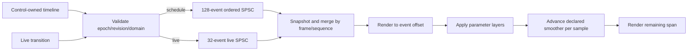

# DSP module framework

## Delivered scope and relationship to the engine

The existing device-independent C++20 Audio library now supplies seven built-in processors: Gain, EQ, Delay, Compressor, Distortion, Chorus and Reverb. `AudioNode` is the single processor base. **`AudioProcessorNode` is a legacy-name alias for `AudioNode`**, not a second hierarchy; the original `GainNode` now derives from `EffectNode` and uses the common parameter/smoothing/bypass implementation. Input/Output routing and the engine's prepared-plan publication, native lifecycle and off-thread reclamation remain in place. Custom node subclasses must follow the new prepare/sample/reset extension contract; this is not a binary or arbitrary external-subclass compatibility guarantee.

| Class | Responsibility |
|---|---|
| `AudioNode` | Prepared limits, immutable parameter definitions, render-owned base/automation/override layers, smoothing, numerical protection, latency-aligned bypass and bounded processing. |
| `EffectNode` | Audio-to-audio extension point; receives immutable upstream samples and owns wet processing state. |
| `GeneratorNode` | Source extension point; ignores upstream audio, fades to silence on bypass. No product oscillator was added. |
| `AnalyzerNode` | Pass-through analyzer extension point and actual peak/RMS meter with lock-free observations of completed 256-frame windows. |
| `ParameterSmoother` | Resettable linear physical-domain ramps measured in samples rather than callbacks. Inputs must be validated by parameter metadata before use. |

These are API-driven processing modules, not a module-browser/inspector redesign. Generic canvas names still have no DSP meaning; opening/editing/loading a project never starts audio. Plugin hosting/export, scripts, MIDI, editable/recorded automation lanes, transport/seek/loop, modulators, feedback graphs, mixing, control-rate nodes and parallel scheduling remain outside this change. The control grid described in `DspArchitecture.md` remains a proposed separate capability; these processors are audio-rate. No deviation from its target-then-smooth or frame/acceptance-order semantics is needed.

## Lifecycle and realtime ownership

All preparation, buffer resizing, initial-value edits and destruction occur off the callback, with rendering quiescent. `prepare(ProcessingSpec)` validates 8-384 kHz, 1-4096 frame capacity, 1-32 channels and processor-specific domains, allocates state and calls reset. A sample-rate/layout change requires stop/reprepare/restart, starting a new engine epoch; it does not reinterpret existing automation timestamps. `reset()` requires exclusive node access and clears filters, delay/reverb/chorus history, LFO phase, detector state, transient parameter layers, bypass ramps and analyzer windows to the prepared initial values. It is not a concurrent control-thread operation on live nodes. Applications should reset large delay-based plans off-callback.

Standalone node users must prepare the intended channel layout before processing and provide valid planar spans. A constructor alone does not negotiate a mono/stereo host layout. `GainNode(gain, sampleRate)` retains its legacy constructor and default stereo preparation, but explicit prepare is the normal lifecycle.

Parameters use at most eight fixed slots per node; bypass has reserved identity 255. Node definitions use immutable static-lifetime metadata. Only the serial render owner changes parameter layers, smoothing or processor history. The control thread validates events using immutable definitions/specs, never reading live filter/delay state. No callback owns/free-releases a graph, constructs an event container, logs, locks, dispatches UI or grows memory.

Graph scratch retains its 64 MiB limit. Combined scratch plus declared processor/dry-alignment buffers is capped at **128 MiB per prepared plan**, with additional bounded object/queue overhead and engine input staging. Delay reserves two seconds/channel; Chorus reserves forty milliseconds/channel; Reverb reserves six fixed sample-rate-derived lines/channel. Prepared active/pending/retired plans can coexist, so this is not a total-process memory limit. Preparation failure does not replace the active plan.

All render atomics (32-bit float bit representations, 64-bit counters, pointers and queue indices) are compile-time required to be lock-free. Window/counter snapshots sample independent atomics, not globally coherent transactions. The implementation uses bounded per-frame math including trigonometric/exponential functions; it is not a guarantee of OS/vendor-driver deadlines or a proof that every libc implementation is hard realtime. Deployment platforms still require qualification.

### Numerical protection

NaN/Inf or magnitude beyond the explicit numerical-integrity guard of 1,000,000 is replaced with zero and counted, including at the Input node. This is a fault-containment guard, **not an audio limiter or a safe listening-level guarantee**. Tiny state/output values below magnitude `1e-20` are zeroed. On x86 SSE, each DSP processing span temporarily enables FTZ/DAZ and restores the host control word; portable explicit state zeroing remains on other architectures. Filter/detector states are protected as well as output samples.

`numericalFaults()` exposes a node's count; engine telemetry reports `latestPlanNumericalFaults` for the latest accepted plan, which may still be pending. Processor-API misuse (unprepared/wrong-shaped spans) increments the same counter and clears bounded valid output spans rather than returning success-shaped stale audio. Host pointer/storage validity remains the caller's contract. Preparation/parameter/schedule validation returns explicit errors; no callback allocates diagnostic strings.

## Parameter definitions (version 1)

Parameter IDs are zero-based in the listed order. Project serialization uses the stable names, not array positions. Initial values apply immediately on reset/prepare; subsequent continuous targets use linear ramps in the stated physical domain.

| Processor | Parameters: name, domain, default, ramp |
|---|---|
| Gain | `gain`: 0-4, 1, 5 ms. |
| EQ | `frequency`: 20-20000 Hz (also <= 45% of negotiated rate), 1000, 5 ms; `decibels`: -24 to +24 dB, 0, 5 ms; `q`: 0.1-10, 0.707, 5 ms. |
| Delay | `seconds`: 0.001-2 s, 0.25, 10 ms; `feedback`: 0-0.95, 0.3, 5 ms; `mix`: 0-1, 0.35, 5 ms. |
| Compressor | `thresholdDb`: -60 to 0 dBFS, -18, 5 ms; `ratio`: 1-20, 4, 5 ms; `attackSeconds`: 0.0001-0.2, 0.01, 5 ms; `releaseSeconds`: 0.005-2, 0.1, 5 ms; `makeupDb`: 0-24, 0, 5 ms. |
| Distortion | `drive`: 1-40, 3, 5 ms; `mix`: 0-1, 1, 5 ms. |
| Chorus | `rateHz`: 0.05-10, 0.8, 5 ms; `depthSeconds`: 0-0.015, 0.004, 10 ms; `mix`: 0-1, 0.5, 5 ms. |
| Reverb | `mix`: 0-1, 0.25, 5 ms; `feedback`: 0.1-0.9, 0.65, 10 ms; `damping`: 0-0.95, 0.3, 10 ms. |

Analyzer has no scalar effect parameters. All Effect/Generator/Analyzer nodes additionally support boolean bypass (exactly 0 or 1). Device Input/Output routing nodes do not support bypass/parameter events. Invalid physical values, non-finite targets and EQ frequencies above the effective sample-rate limit are rejected, not silently clamped to a different requested setting.

Layer precedence is live override > enabled automation > saved base. `base` updates the base without overwriting active automation/override. `automation` enables/updates its target. `overrideValue` sets a temporary live override; `releaseOverride` resumes the latest automation or base, and `disableAutomation` restores base unless an override remains. Repeated identical targets do not restart ramps. A new target during a ramp starts from the current effective value. Reset discards transient runtime layers rather than persisting them.

`setGain()` remains available and delegates to the common live parameter queue as an explicit override; it does not introduce a second gain smoother. `setParameter()` handles all other live transitions. Persisting a live change remains an explicit workspace/history operation, not a hidden consequence of the renderer.

## Automation timing and bounded delivery

The engine supplies an epoch and a monotonically processed-frame `samplePosition`. New starts increment the epoch and begin at frame zero; structural replacement does not reset that session clock. Timestamped events identify epoch, latest accepted graph revision, stable node, parameter, action and intended absolute frame. Control validation resolves an immutable prepared node index, so deleted/reused identities cannot be targeted through dangling pointers.

- `scheduleParameter()` accepts **at most 128 queued events**, in nondecreasing absolute frame order within the latest accepted revision, no more than ten seconds ahead of the admitted render horizon. Publishing a new revision resets that ordering floor, since older-revision events will be cancelled regardless of timestamp. Keep distant/unsorted timeline content on the control thread and feed the queue in order. Queue full, wrong epoch/revision, invalid target, late timestamps or order/horizon violations return explicit errors without silently discarding previously accepted events.
- A separate **32-entry live queue** handles unscheduled changes at the next eligible nonempty callback boundary. Live changes are responsive but have no sample-accurate wall-clock promise.
- Both queues use a common acceptance sequence. Events are ordered by applied frame, then sequence, including live transitions and scheduled points at the same boundary. Last accepted target wins at the same frame; override/release actions are never silently coalesced.
- At callback admission, snapshot queue counts bound work to at most **160 events**. New writes after that snapshot wait for a later callback. The schedule floor is advanced to the admitted block end before consumption. A producer racing admission may have accepted just before that floor changed but delivered too late; the event is explicitly counted as missed, never replayed in a later block as if punctual.
- The engine renders subspans up to each event boundary, applies ordered targets **before that sample**, then renders the remainder exactly once. An event at the exclusive block end waits for the next block. This adds neither an extra callback of latency nor a callback-size-dependent automation grid.
- Scheduled automation targets are sample-accurate; their **audible effect is still smoothed afterward**. Five milliseconds at 48 kHz is 240 processed samples. A zero-frame callback can activate a prepared graph but consumes no parameter events or sample/ramp time.
- Old-revision events are cancelled and counted. Future-revision messages wait for activation; if their scheduled frame passes before activation, they become missed rather than being applied retrospectively. Graph replacement resets processor state to prepared initial values; no state migration is implied.

Telemetry reports applied/cancelled/missed event counts and last applied acceptance sequence/frame, independently sampled. The legacy `canceledGainChanges` field continues counting cancelled **live parameter** messages for source compatibility; `canceledEvents` covers both queues. Accepted events remain pending until an eligible callback, explicit cancellation or session stop. Stop discards queued events and ends the epoch; next start resets all event counters. No persisted automation lanes/recording format is introduced.



### Minimal API example

```cpp
using namespace val::audio;
AudioGraph graph{2,
    {{1, AudioNodeType::input}, {2, AudioNodeType::delay}, {3, AudioNodeType::output}},
    {{1, 2}, {2, 3}}};
graph.nodes[1].parameters = {
    {std::uint16_t{0}, 0.25f}, {std::uint16_t{1}, 0.35f}, {std::uint16_t{2}, 0.5f}};
// Use engine.start(selectedBackend, explicitRequest, graph, revision) for hardware,
// or startOffline() for a host that owns/quiesces its serial render source.
// Check every Result before proceeding. No device opens merely by creating a graph.
```

For generic project nodes: exact `audio.type` strings are `Input`, `Output`, `Gain`, `EQ`, `Delay`, `Compressor`, `Distortion`, `Chorus`, `Reverb`, `Analyzer`; `audio.param.<name>` stores a finite scalar parameter and `audio.bypass` stores a boolean. Gain's existing `audio.gain` remains supported, but supplying both it and `audio.param.gain` is rejected. Unknown/out-of-range processor parameters fail mapping/preparation. Existing project persistence already round-trips these scalar fields; no breaking schema change or automatic UI processor creation is required.

## Processor algorithms and intentional limits

- **EQ:** One RBJ peaking biquad, transposed direct form II with independent double-precision channel history. Coefficients are recomputed by bounded per-frame math from smoothed Hz/dB/Q targets, so there is no callback-size-dependent coefficient update rate. This is not a multiband parametric equalizer. Rapid/high-Q modulation may still produce transients; numerical fault containment is not a musical stability/perceptual qualification.
- **Delay:** Independent fractional linear-interpolated circular lines. Feedback is below unity; smooth delay-time changes intentionally produce pitch movement, not a dual-head click-free time teleport. Reset removes the tail.
- **Compressor:** Feed-forward stereo/multichannel-linked peak envelope, exponential attack/release, hard-knee dB gain computer and makeup. No lookahead, oversampling, sidechain routing, soft knee or limiter.
- **Distortion:** Odd-symmetric tanh waveshaping normalized at unit input, plus mix. No oversampling or antialias filter: aliasing at strong drive/high frequencies is a disclosed quality limit, not claimed production mastering quality.
- **Chorus:** 20 ms nominal fractional delay with sine LFO, at most 15 ms depth, odd/even channels 90 degrees apart. No feedback. LFO phase advances only by samples; delay and phase reset deterministically.
- **Reverb:** Original implementation of the published Schroeder family: four parallel feedback combs with one-pole damping, followed by two true serial allpasses. Comb times are 29.7/37.1/41.1/43.7 ms and allpasses 5/1.7 ms, rounded up plus two guard samples; odd channels add 0.7 ms. This is intentionally a small algorithmic reverb, not convolution or a copy of Freeverb/vendor source. State is independent per channel, and feedback remains below unity.

All supplied processors declare **zero additional algorithmic pipeline latency**. Delay/chorus/reverb intentional wet timing and decay are effects, not compensation delays; they must not be added as host latency to every dry/bypassed sample. The base still supports a declared bounded nonzero latency: bypass uses preallocated matching dry delay and a five-millisecond linear crossfade. A test-only one-sample processor verifies compensation. Future nonzero-latency processors need graph/host latency reporting qualification before addition.

Bypass preserves channel count and **keeps wet state processing** behind the dry crossfade, so unbypass does not restart a frozen delay/filter. This is a click-reducing signal transition, not silence detection, tail spill routing, a CPU-saving suspend mode, or a guarantee against arbitrary discontinuities already present in the input. Generator bypass crossfades to silence; analyzer windows continue behind bypass.

## Algorithm references and originality

Only public mathematical algorithms were used; no third-party implementation source or proprietary impulse response was copied.

1. Robert Bristow-Johnson, [Audio EQ Cookbook, W3C Audio Working Group Note](https://www.w3.org/TR/audio-eq-cookbook/): peaking-EQ coefficient formulas.
2. Julius O. Smith III, *Physical Audio Signal Processing*, [Schroeder Reverberators](https://www.dsprelated.com/freebooks/pasp/Schroeder_Reverberators.html): published feedback-comb/allpass architecture and references to Schroeder's early work. Our topology/state/buffer code and channel tuning are original; the cited page's Chowning mixing example is not copied.

## Verification

`Audio.Dsp` is an offline deterministic suite, never application startup and never hardware playback. It checks each processor's impulse/frequency/level behavior, stereo independence, state reset, rates, host partition invariance, smoothing/parameter layers, same-frame live/scheduled ordering, epoch/revision rejection, event overflow, malformed numerical inputs, maximum delay, prepared memory limits, analyzer observations, generator semantics and latency-compensated bypass.

The suite also renders all seven processors plus Analyzer in one stereo graph for 2000 blocks of 128 frames with 128 scheduled EQ targets. Engine duration/load is printed as an **unpaced synthetic workload**, not hardware measurements. Global ordinary/array/aligned/sized C++ allocation overrides assert zero callback-thread allocations **and frees**, including parameter processing and split spans. This does not instrument every C-library/OS/vendor allocation.

```powershell
ctest --test-dir build\windows-native -C Debug --output-on-failure
ctest --test-dir build\windows-native -C Release --output-on-failure
.\build\windows-native\tests\Release\VisualAudioLab.Dsp.Tests.exe
```

No audible output, native streaming or ASIO capability probes are needed by these DSP checks. Windows build/test evidence and exact limits are saved in the session report. macOS/ARM, physical listening, race sanitizers, perceptual effect quality and hard realtime scheduling still require separate qualification.
