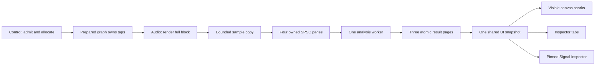

# Signal visualization: implemented Version 1

This is the implementation companion to [VisualizationArchitecture.md](VisualizationArchitecture.md).
The architecture is preserved unchanged as supplied; its candidate budgets, future workspaces,
and future products are proposals, not claims that they are implemented or qualified.

Implemented: Oscilloscope, Spectrum Analyzer, Peak Meter and RMS Meter. There are no new
effect processors, spectrograms, true-peak meters, LUFS meters, audio devices or automatic playback.
The structural editor now has [desktop runtime composition](DesktopWorkflow.md): executable
modules register scheduled captures on explicit Start, and valid live edits update producers.
The shell displays **No target**, not fabricated audio, until a real source is scheduled.
Device-free desktop preview and tests process deterministic buffers through the real offline AudioEngine.

## Classes and ownership

| Class | Responsibility |
|---|---|
| `SignalCaptureBuffer` | Four preallocated SPSC pages, at most 2048 frames and two selected channels/page; immutable source/rate/channel selection. |
| `AnalyzerEngine` | One shared analysis worker, fair packet round-robin, prepared windows/FFT scratch, admission and off-callback metrics. |
| `AnalysisResults` | Three preallocated worker/UI pages with atomic Free/Writing/Ready/Reading ownership; bounded newest-copy consumption. |
| `VisualizationSession` | One message-thread scheduler and one shared newest immutable UI copy per source; source lifecycle and visible demand fan-out. |
| `VisualizationWidget` | One calibrated rendering and independently validated refresh control; no capture/analysis/timer of its own. |
| `VisualizationWidgets` | Embedded, inspector or pinned-monitor host; target, pin, freeze, hold reset and four view products. |

`AudioNode` remains the unified DSP base, with `AudioProcessorNode` its existing alias.
`AnalyzerNode` is still an EffectNode/pass-through endpoint, **not a parallel processor hierarchy**.
Its old callback peak/RMS accumulation has been removed. Legacy `snapshot()` now reads
worker-published independent fields, with `windows == 0` until an explicit capture is analyzed.
Those legacy fields are not a coherent transaction; new displays use `SignalAnalysis`.
`reset()` of an isolated AnalyzerNode does not reset a separate observation worker.
A stream epoch, graph revision, discontinuity or new transport resets analysis continuity.

Any already-scheduled built-in node can have `AudioNodeDefinition::capture` attached before
graph preparation. The graph validates source ID, sample rate, channel span and resource limits.
Capture does not make a pruned/disconnected branch execute. After *all* in-block automation
spans have rendered, AudioEngine copies each tapped node's complete output once, carrying:
node ID, graph revision, stream epoch, absolute first sample frame, sample rate, channel
selection, frame count, sequence and producer drop count.

Preparation/registration, shared-pointer changes, destruction and registry mutexes are all
**off the audio callback**. Prepared steps retain transports across graph swaps; callback
capture only borrows their raw objects and does not decrement ownership. Existing pending-plan
and off-thread retirement rules are unchanged. Removing an observation generation permanently
retires/disables its transport; a new generation requires a new transport. A racing last
producer copy can finish safely because the prepared graph still owns it. Never reuse a
retired ring or manually delete storage still borrowed by a producer.

The basic engine has one active graph. Node IDs are scoped to that graph/observation session,
not global identifiers across every project. Successful load and active-patch transitions
reset all shell targets (including pins), detach old observation generations, and clear caches.
External hosts must likewise detach/re-register when changing project identity; revision/epoch
metadata distinguishes changes within one active graph. No observation target/settings are
added to the `.valab` schema in this change.



### Transport, loss and throttling

There is **nonzero** audio cost: bounded copies, provenance and lock-free atomic publication.
No FFT, square/peak accumulation, windowing, allocation/free, clock query per tap, logging,
mutex, ref-count operation, UI notification or retry loop is performed in capture.
The entire callback is bounded by the existing 4096-frame capacity and at most eight taps.
Each capture call segments into at most two pages. Compile-time assertions require the
callback's bool/32-bit/64-bit atomics to be always lock-free on the build target.

Only the producer advances write, only ingestion advances read. A full ring **drops incoming**
pages, saturating its drop counter; unread data is never overwritten. The worker first copies
an owned page to prepared scratch and releases it, then analyzes. Absolute sample gaps and
revision/epoch transitions clear partial RMS/FFT history, smoothing/hold and spectrum averages.
Invalid (NaN/Inf or magnitude above the runtime's numerical guard of 1e6) samples invalidate
continuity; valid contiguous samples must refill windows. Invalid counts are distinct from silence.
Invalidation is constant-time: old history/FFT storage is gated by fresh coverage rather than
cleared on each malformed sample. Engine input/processor numerical guards may already have
sanitized upstream faults; taps truthfully observe those actual outputs. Consult the engine's
separate numerical-fault telemetry for faults before the observation point.

Results recycle a Ready page, never a Reading page. The sole UI consumer claims/copies/releases
in at most three attempts and rejects older sequences. UI freeze makes its own bounded copy,
not a retained transport lease. UI polling does not lock the analysis registry.
Control-only source edits and diagnostics may lock; they are not realtime APIs.

Admission: eight unique sources, sixteen selected mono-equivalent channels, **768,000 float
samples/second (3.072 MB/s payload)**, and 64 MiB analysis storage. Thus high-rate observation
admits fewer channels. Compatible views use the same source/profile/results rather than
starting more analyzers; duplicate source registration is an explicit error. A source supports
108 active graphical host demands. These limits apply per observation service, not per
project file. The UI service additionally bounds registered hosts to 128 (including hidden
hosts); construction beyond that limit throws an actionable budget error. The shell has one
service. Do not construct one service per module.

The worker processes at most one page/source/round, then yields for 1 ms (3 ms when idle);
it has no hard realtime deadline. Paused/hidden/frozen/offscreen hosts stop their demand.
The last demand disables copying; a finite already-queued backlog may drain. Pinned is not
background-armed. Canvas sparks share the same results, draw only visible registered nodes,
refresh at 10 Hz, and disappear below 75% zoom. They allocate no per-node components or FFTs.
No timer is created per plot or per node.

## UI

The Property Inspector hosts four shared-result tabs. A single selected node targets that
node's runtime output; selecting a wire resolves its upstream source. Multiple/absent selection
has no implicit mixed target. The source selector lists admitted runtime endpoints. Structural
nodes without a scheduled endpoint show **Unsupported / not scheduled**. Pin separates target
from editor selection and keyboard focus. Inspecting never inserts or edits a graph.

**Signal Inspector** opens a persistent non-modal, resizable, pinned four-plot window. Closing
hides it and suspends demand; reopening reuses it. There is no competing Signal Info analysis
engine: provenance and analysis timing are metadata in this same host. Broader workspace
presets/docking, arbitrary endpoint/channel configuration, profile editing and accessibility
screen-reader plot navigation remain future UX work; controls have names, descriptions and
normal JUCE keyboard focus.

Embedded defaults to 10 Hz (1-15); inspector defaults to 20 Hz (1-30); monitor defaults to
30 Hz (1-30). Each plot validates its requested rate; unsupported values return errors, not
silent clamps. A shared 30 Hz UI scheduler samples deadlines, so requested rates are maximums
and non-divisors can run slower; OS scheduling is not guaranteed. 60 Hz is deliberately not
enabled without qualification. Hidden tabs do not repaint.

States distinguish no target, unsupported, waiting/preparing, live, degraded/gaps, stale,
frozen, audio stopped and target removed. After 500 ms without a new UI-received result,
data is visibly stale, not current zero. Stopped/removed sources clear current values.
Unfreeze waits for a new sequence rather than presenting a frozen cache as live.
The footer's **UI received age** is a local freshness indicator, not measured capture age,
device latency or physical roundtrip. Explicit stream lifecycle notifications should call
`setState`; the view does not guess whether a device is running.

## Calibration and algorithms

All measurements are per selected channel and use digital amplitude **1.0** as full scale.
There is no physical voltage/SPL calibration.

| Product | Reference, window and behavior |
|---|---|
| Oscilloscope | Latest contiguous up-to-4096 samples; 512 min/max envelope bins, reduced again preserving extrema for smaller views. Amplitude grid +/-1. Free, rising or falling trigger; channel 1 trigger level, configurable 0-2048 pretrigger frames and 512 posttrigger frames. Without a crossing it shows the latest free-running span with `triggered=false`. |
| Spectrum Analyzer | Periodic Hann, default N=2048; admitted powers of two 1024-8192. 50% overlap. Radix-2 Cooley-Tukey transform on worker. Dominant **bin**, not a guaranteed fundamental; frequency resolution `sampleRate/N`. |
| Peak Meter | **Sample** peak of latest 50 ms; not intersample/true peak. Warm-up validity explicit. Display/hold inspect every worker-side sample, retaining impulses even in host packets longer than 50 ms. Instant display attack, 20 dB/s release; peak hold 1 s then 12 dB/s release. Hold reset is observation-only. Ballistics advance in audio-sample time on worker, independent of refresh or packet partitioning. |
| RMS Meter | Raw square-root mean square over latest 300 ms (profile 10-1000 ms); requires complete contiguous coverage. No extra attack/release envelope; rectangular rolling integration defines response. Amplitude 1 DC/square = 0 dBFS; full-scale sine = **-3.0103 dBFS**, not AES17's sine-referenced +3.0103 dB offset and not LUFS. |

Spectrum amplitude uses `abs(DFT) * endpointFactor / sum(window)` where endpointFactor is 2
except DC/Nyquist (1). Hann coherent gain is 0.5. Averaging is linear **power**, default 100 ms
exponential time constant (`alpha = 1-exp(-hop/(rate*time))`), not averaging dB values.
Zero averaging selects the latest transform. A bin-centred full-scale sine reads 0 dBFS
peak amplitude; non-bin-centred sinusoids have expected Hann leakage/scalloping.
No misleading zero-padding/interpolated-frequency precision is claimed.

PSD is separately available as one-sided power/Hz:
`endpointFactor * averaged(abs(DFT)^2) / (rate * sum(window^2))`.
Hann ENBW is `N*sum(window^2)/sum(window)^2 = 1.5 bins` and is also reported in Hz.
This window-energy normalization (rather than dividing peak amplitude by ENBW twice)
makes PSD integrated across bins equal raw mean-square power. The UI spectrum plots
peak-amplitude dBFS; it does not label PSD as the same quantity. Measured zero amplitude
is negative infinity dBFS; the plot floors at -120 dB only for drawing.

Over-range count is samples with absolute amplitude >=1, not a reconstruction/clip detector.
Worker results also contain signed mean, min/max, FFT calibration, provenance, coverage,
invalid counts, drop counts and analysis duration. They are coherent snapshots, not separately
sampled counters. The legacy meter API is deliberately weaker and should not drive new displays.

References: [Harris, windowing for harmonic analysis (IEEE)](https://doi.org/10.1109/PROC.1978.10837)
for coherent gain/noise bandwidth; [Cooley and Tukey (1965)](https://doi.org/10.1090/S0025-5718-1965-0178586-1)
for the radix-2 FFT. No external DSP source or copyrighted algorithm implementation was copied.

## Integration sketch

On the owner/message thread, create a SignalCaptureBuffer with the stable scheduled node ID,
negotiated rate and selected channel span. Register it with the shared VisualizationSession
(or AnalyzerEngine for a headless host); surface the returned admission error. Attach it to
that node's AudioNodeDefinition, then prepare/publish the graph through AudioEngine as before.
Views acquire demand only while useful. Notify stream stop/device loss and retire observations
before rebinding another project/patch. Plan retirement retains callback storage until safe.
Profile changes require new capture/worker state off-callback; never resize live FFT/history.

## Validation and reproducible metrics

`Audio.Visualization` checks known bin-centred sines at 44.1/48/96 kHz and several frequencies,
DC/silence/square/impulse, raw RMS, sample peak/hold/release, scope extrema/trigger, FFT sizes
1024/2048/8192, off-bin error, coherent gain and ENBW-integrated PSD. Tolerances:
bin-centred amplitude +/-0.002 dB, sine RMS +/-0.035 dB (finite window phase), dominant
bin +/-half-bin, DC/impulse/PSD power +/-1e-5 or tighter. It also checks gaps, invalid samples,
epoch/revision changes, admission, retirement, queue ownership, concurrent result publication,
channel selection, split capture, and exact real-engine output matching with in-block automation.
C++ allocation/free instrumentation is thread-local and covers ordinary/aligned/sized forms,
not every C library, driver or OS allocator.

```powershell
ctest --test-dir build\windows-native -C Release --output-on-failure
.\build\windows-native\tests\Release\VisualAudioLab.Visualization.Tests.exe --stress
.\build\windows-native\tests\Release\VisualAudioLab.Presentation.Tests.exe --visualization
```

The offline capture stress uses 8 stereo sources, 48 kHz, 512 frames, 2000 blocks, with
100 shared embedded demands plus eight detailed demands. It prints p50/p99/max aggregate
capture time, p99 fraction of a callback period, max analysis job time, storage and drops.
A deliberately stalled 20-block consumer checks exact full-ring loss. A separate GUI stress
uses actual widgets for 100 logical embedded hosts plus eight detailed hosts sharing one
source. It forces full software snapshots of a 3200x2000 logical wall, including child controls,
and prints frame/individual-plot times. This is a conservative **whole-wall repaint** test,
not proof that 108 plots update simultaneously within 4 ms on a physical display.
The default test runner does not write screenshots; an explicitly set
`VAL_VISUALIZATION_SCREENSHOT` output path saves a real four-widget PNG.

These are synthetic/offline measurements, not real-device audio or hardware/GPU benchmarks.
The architecture's capture p99 <=1%, worker 2 ms and UI 4 ms targets are qualification goals,
not guarantees; full-wall rendering may exceed the UI target and is reported as such.
No audible output or unattended ASIO/exclusive stream is needed. Platform/hardware scheduling,
macOS/ARM and physical loopback calibration remain unqualified. Exact build/test results,
measured values and screenshot are recorded in the accompanying session report.
