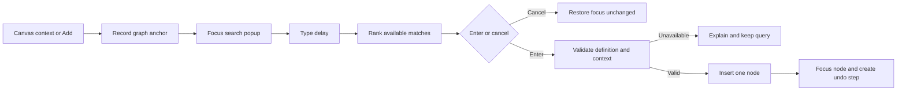
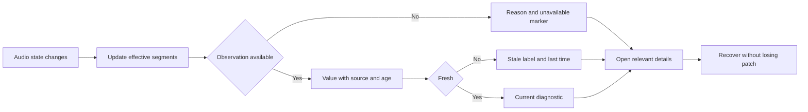

# Visual Audio Lab: UX Review and Workspace Redesign

## Status, evidence and decision boundary

This is a **design proposal, not an implementation specification or usability-test report**. It reviews the JUCE application shell at commit `dd74079` and proposes an interaction architecture for a future product. No participant research, comparative task timing, accessibility qualification or audio-performance measurement was conducted for this review. All expected productivity improvements are hypotheses to validate.

The evidence is the implemented Presentation classes, their Desktop composition and tests, and inspection of the captured Windows shell window. The screenshot shows the default `Untitled` workbench: Module Browser and Project Explorer tabs on the left, Patch Canvas centrally, Property Inspector on the right, and Audio Settings spanning the bottom. The screenshot is a session artifact, not a new repository asset; the code references below make this review traceable without depending on that artifact.

| Evidence | What it establishes |
|---|---|
| [MainComponent.cpp](../src/VisualAudioLab.Presentation/src/MainComponent.cpp), `resized`, command registration and menus | Fixed perimeter sizes; File/Edit/View/Audio menus; service-backed temporary rename/undo/redo; panel navigation; no graph editing. |
| [DockWorkspace.cpp](../src/VisualAudioLab.Presentation/src/DockWorkspace.cpp), panel construction, move/rebuild and resize behavior | Five placeholders; repeated headings and dock selectors; four fixed tab destinations; header dragging; panel hiding/reopening; bounded dividers; no floating or auto-hide windows. |
| [DockLayout.h](../src/VisualAudioLab.Presentation/include/val/presentation/DockLayout.h) | All panels initially visible; canvas protected against hiding; transient destinations/visibility only. |
| [ShellChrome.cpp](../src/VisualAudioLab.Presentation/src/ShellChrome.cpp) | Fixed-width rename/history/settings/reset toolbar; text status and explicit audio-unavailable disclosure. |
| [Main.cpp](../src/VisualAudioLab.Desktop/Main.cpp) and [Settings.h](../src/VisualAudioLab.Application/include/val/application/Settings.h) | Native desktop window, minimum window size, local size/inspector preferences; no persisted complete workspace layout. |
| [PresentationTests.cpp](../tests/PresentationTests.cpp) | Structural command/navigation/ownership/rendering checks, not evidence that users understand docking or that assistive technology works. |

### Relationship to existing documents

Read this alongside [ProductVision.md](ProductVision.md), [PRD.md](PRD.md), [UxBlueprint.md](UxBlueprint.md), [UiPrototypePlan.md](UiPrototypePlan.md), [TechnicalArchitecture.md](TechnicalArchitecture.md) and [AudioPlatformStrategy.md](AudioPlatformStrategy.md).

The earlier prototype plan deliberately excludes floating windows, arbitrary docking and persistent layouts. This review explores those capabilities **because the present UX request explicitly asks for them**; it does not retroactively change that study's scope or claim they belong in the MVP. Likewise, advanced signal analysis, scripting, MIDI, VST3 hosting and export remain future designs without a release commitment. No other document is amended. Preserve the existing principles of offline use, explicit device selection, accessible graph alternatives, reversible edits, honest unavailable states and host-neutral processing boundaries.

## Executive recommendation

Make the patch the primary working surface, **Quick Add the primary insertion path**, and the browser the discoverable learning/catalog path. Replace permanent layout controls with conventional tab headers and contextual docking guides. Consolidate editing into one Property Inspector and measurement into one persistent Signal Inspector. Move Audio Settings out of the default dock layout into a non-modal settings document. Use a compact, actionable diagnostics strip rather than a stream of generic status sentences.

This is a workbench, not a DAW timeline or an IDE that requires code. Preserve the reassuring menus, component vocabulary and direct manipulation associated with Turbo Pascal, Visual Basic, LabVIEW and Pure Data without copying their interfaces or inheriting all of their conventions. A musician should be able to browse without knowing a module's name; a returning programmer should be able to find commands and dependencies; a sound designer should be able to navigate, compare and measure a large patch without reorganizing windows repeatedly.

## Current UI critique

The shell is a useful technical baseline: ownership is clear, the palette is coherent, named views can be reopened, layout changes are isolated from document history, and unavailable audio operations are honestly disclosed. Its empty regions are intentional placeholders, not evidence of failed module discovery or a missing audio implementation.

| Observed prototype behavior | Usability risk or limitation | Proposed response and rationale |
|---|---|---|
| Each panel repeats its name in a tab and heading, followed by a full-width `Dock: ...` selector. | Permanent layout machinery competes with the content it is meant to organize. Docking destination is not the user's frequent task. | One compact tab/title row; move layout commands to its context menu and keyboard actions. Show guides only during arrangement. |
| Audio Settings occupies at least 190 logical pixels, or a larger proportion, of the workspace when present. | In the captured default layout it consumes substantial vertical space despite having only disabled choices. The canvas loses room before patch content exists. | Settings is opened on demand; reserve the bottom dock for signal inspection or diagnostics when needed. |
| Left and right docks consume fixed proportions, including when displaying only an empty-state label. | Large empty surfaces make the prototype look sparse; three-column layouts may crowd content at narrow widths or increased text size. | Presets, auto-hide rails and content-based minimums; never shrink text to keep every pane visible. |
| Temporary workspace name and Rename occupy the start of the toolbar. | A framework demonstration is visually promoted over likely graph tasks; it could be mistaken for project management. | Show document identity in the title/tab; future Rename is contextual. Keep the existing prototype's temporary semantics until real projects exist. |
| The toolbar foregrounds Audio Settings and Reset Layout; no Add, search or framing controls exist. | This validates commands, not a productive authoring loop. | Prioritize Add/search, history, framing and explicit audio transport; move infrequent layout reset to Window. |
| View contains both a Property Inspector navigation command and a separate visibility toggle. | Two routes with similar names require users to infer focus versus hide semantics. | `View > Panels > Property Inspector` reveals/focuses; close/auto-hide live on the panel header; state remains visible in Window. |
| Layout resets on restart except for window size and inspector visibility. Empty peripheral docks collapse. | No saved task context or obvious pointer target for a collapsed destination; the selector currently provides the alternative. | Persistent named workspaces, transient edge drop targets and explicit recovery commands replace the selectors. |
| Patch Canvas is a dotted placeholder; browsers contain no catalogs; inspector has no selected objects. | No evidence yet about node legibility, search quality, graph scale or selection consistency. | Design these explicitly and validate with task fixtures rather than interpreting empty space as a measured usability failure. |
| Status is generic text plus `UI ONLY` and `Audio unavailable`. | Appropriate honesty now, but insufficient provenance/action for a future running engine. | Keep that honesty; evolve to segmented effective-state diagnostics only as real observations become available. |
| One banner permanently explains scope. | Helpful for prototype interpretation, but repeated capability messaging adds chrome. | Keep a concise `UI prototype - audio unavailable` identity in prototype builds; use contextual explanations. Do not remove all disclosure or imply operational sound. |

There are no measured claims here that docking, search or any competitor-inspired pattern is faster for these users. They are plausible responses to visible hierarchy and space-allocation problems.

## Proposed information architecture and shell

Separate three concepts: **documents** (patches, future scripts and settings), **tools** (browser, explorer, properties, signal inspection), and **application state** (audio lifecycle, diagnostics and workspace layout). Document tabs do not impersonate tools; tool visibility does not change processing.

### Main workbench wireframe: Patch Design

```text
+-----------------------------------------------------------------------------------+
| File  Edit  View  Patch  Audio  Window  Help                Workspace: Patch Design  |
| [Add / Search] [Undo] [Redo] [Fit] [100%]      [Start Audio] [Stop Audio] [Commands]  |
|-----------------------------------------------------------------------------------|
| Project: Untitled*           [Patch 1] [Audio Settings, only when opened]             |
|---------------------+----------------------------------------+--------------------|
| Modules | Explorer  | Patch > Group breadcrumb                | Property Inspector |
| Search modules...   |                                        | Follow / Pin       |
| Favorites           |   [Input] ------> [Filter] ----> [Out]   | Properties | Params|
| Audio I/O           |                   |                    | Docs | Signal Info |
| Basic               |        [Comment / group frame]         | Named fields       |
| Filters             |                                        | units and errors   |
| ...                 |                           [Minimap]    |                    |
|---------------------+----------------------------------------+--------------------|
| Auto-hide: Signal Inspector | Problems | Script Console (only when delivered)       |
|-----------------------------------------------------------------------------------|
| Stopped | ASIO: No device [Configure] | Rate -- | Buffer -- | Latency -- | DSP -- ...|
+-----------------------------------------------------------------------------------+
```

`*` means an unsaved document only in a future implementation that actually tracks persistence. It must not be added as a false success/dirty indicator to the current temporary workspace.

Use one concise primary toolbar, with text labels on critical controls and accessible names/tooltips on icons. Keep Start and Stop separate, never a spacebar play/stop toggle. Add, history and viewport actions precede less frequent configuration. The command palette searches commands, not modules; `Add / Search` opens module Quick Add. Menus provide equivalent named actions and show current shortcut assignments. Platform-native menu placement applies, including macOS application Settings and Quit.

No nested toolbar ribbons or permanent docking selectors. Put canvas-specific snapping, alignment and minimap options in a lightweight canvas strip/context menu; let users hide the strip without losing menu access. Keep the current dark direction, add validated high-contrast variants and adjustable text density; no icon-only cryptic learning mode.

## 1. Docking system

### Proposed interaction contract

Replace **all** `Dock: Left/Right/Bottom/Centre` dropdowns. A tab is the drag handle for a panel; a group header moves a tab stack. After deliberate movement, show transient edge and local split/tab targets, including targets for collapsed regions. Hovering a target previews the exact resulting rectangle and names the operation, such as `Tab with Project Explorer` or `Split right of Patch`. Dropping commits once; Escape restores the original arrangement. Do not steal a graph node drag or dock when a pointer merely crosses a window.

| State/action | Behavior |
|---|---|
| Docked | Tab stacks and horizontal/vertical splits; minimum sizes based on readable content and scaled controls. Split preview rejects layouts that cannot fit. |
| Tabbed | Tab title, active/focus state, optional pin and overflow list. Reordering does not change project selection. Drag tab for one panel; group header for a stack. |
| Floating | Drop outside application frames or use `Float Panel`. Native owned tool window with title, close and Dock Back. Closing a tool hides it, not the document or application. |
| Auto-hide | Explicit `Auto-hide` action places a labeled tab on an edge rail. Click/keyboard activation opens a temporary overlay; Pin reserves dock space. Hover preview is optional, never the only path. |
| Hidden | Removed from rails; `View > Panels` or the palette reopens/focuses the existing instance at its last viable position. Hidden is distinct from auto-hidden. |
| Locked | `Window > Lock Layout` prevents accidental rearrangement, not normal panel interaction. A visible menu check explains rejected drags. |
| Reset | `Window > Reset Current Layout` restores that preset's arrangement and safe focus, preserving documents, audio state, drafts and edit history. Offer immediate layout-only Undo. |

Auto-hide overlays stay open while they contain focus or an active edit, menu, drag or validation error. Moving the pointer away must not dismiss a keyboard user's panel. Escape first cancels the local interaction; a subsequent Escape dismisses the overlay and restores the invoker. Announce expanded/collapsed state and whether a panel is pinned. Avoid auto-hide for the primary patch document.

### Non-drag alternatives, focus and accessibility

Each header context menu and `Window > Arrange Panel` exposes Dock, Float, Auto-hide, Move to Group, Move to Monitor and Adjust Size. A keyboard Move Panel mode selects a named destination with arrows and announces the preview; Enter commits, Escape cancels. Keyboard resize provides stepped adjustments and a reset. A searchable window list reveals hidden, floating and auto-hidden panels without cycling blindly.

Maintain separate document selection, keyboard focus and inspector target. Focusing a toolbar or floating panel never selects a different node. After docking, focus stays in the moved panel; after hiding it, return to its invoker or last active document. F6/Shift+F6 cycle visible workspace regions, including owned floating tool windows, in documented logical order; tab navigation stays within controls. A `Focus Region` command avoids dependence on function keys. Screen-reader headings identify each dock, active tab, panel state and resize control.

### Layout persistence and recovery

Persist layout as **machine-local application preference**, not patch content: panel identities, split proportions, active tabs, auto-hide state, floating bounds, text-density choice and workspace name. Keep per-document selection/view navigation separately from layout. Saving, restoring or changing layouts must not dirty a patch or enter patch undo history. Do not persist signal samples, plugin binaries or device indices in a layout.

Built-in presets are immutable templates; alterations create a `Modified` state. `Save Workspace As...` is an inline rename field, not a blocking wizard; `Revert Preset` and delete-custom actions are available from Window. Restore last valid layout on launch. Reject an incompatible/corrupt layout with a visible explanation and use a known-safe template; retain the rejected preference for recovery rather than silently overwriting it.

On monitor removal, DPI change or remote-session reconnect, clamp floating windows to an available work area with title bars reachable, then merge windows that cannot meet readable minimums into the main dock. Never hide an active draft off-screen. `Window > Bring All Panels Here` recovers all tools onto the current display; `Reset Current Layout` is the stronger fallback. Restoring a saved multi-monitor layout on a laptop must not reopen invisible windows. Display changes affect placement only, never restart audio.

**Tradeoff:** Full docking adds focus, ownership, restoration and accessibility complexity. Ship reliable tab/split/keyboard recovery before floating and auto-hide; the complete target design supports all requested states but is not a mandate to build them in one release. Keep beginner presets conservative and layout lock discoverable.

## 2. Scalable Module Browser

Use a searchable tree with precisely these top-level categories: **Audio I/O, Basic, Filters, Dynamics, Delay, Modulation, Analysis, Logic, Scripts, VST Plugins**. These are proposed catalog roles, not a claim that such modules ship today. Categories may show an honest empty state; Scripts and VST Plugins explain their unavailable capability until delivered, rather than fabricating entries.

```text
+--------------------------------------+
| Modules                 [Tree / List]|
| [Search modules...                x] |
| [Favorites] [Recent] [Compatible]     |
| v Favorites                          |
|   Delay - Mono              [star]   |
| > Audio I/O                          |
| > Basic                              |
| > Filters                            |
| v Delay                              |
|   Delay - Mono    1 in / 1 out        |
|   Delay - Stereo  2 ch               |
| > Modulation                         |
| ...                                  |
| Delay - Mono                         |
| Short purpose; ports; units; [Help]  |
| [Insert into active patch]           |
+--------------------------------------+
```

The example result is illustrative, not installed content. Tree expansion survives search clearing. Search flattens matching descendants with category breadcrumbs; results never disappear merely because a parent was collapsed. Match names, aliases, purpose and tags; display why a match appears. Favorites use stable module-definition identities, remain local and survive upgrades; a missing favorite stays visibly unavailable until removed. Recent reflects accepted insertions, not hover, and can be cleared.

Quick filters include compatible port/rate, channel count, installed/available and source (built-in/user/plugin). Show active filter chips, result count and `Clear filters` prominently. Keep text filters conjunctive and explain zero results with actions to clear constraints. A compatible-only default applies to port-origin insertion, not ordinary catalog exploration.

Single-click selects a definition and shows a concise summary; it does not instantiate DSP or load a plugin. Drag previews insertion in the canvas; Enter or the labeled Insert action inserts into the active patch at its insertion cursor. With no patch destination, explain what must be opened instead of silently creating content. Show a drag ghost and exact drop location; cancel changes nothing. Category labels are not draggable nodes.

Tree/list controls expose names, hierarchy, expansion, favorites and availability to assistive technology. Arrow navigation, typed search and explicit Insert are equivalent to dragging. Include local examples and documentation for learning; do not make catalog use depend on network access.

**Rationale:** Browsing answers "what can I build?" while Quick Add answers "give me the thing I know." A text-only palette cannot replace the beginner's category map, but the category tree should not force experts to expand branches for every insertion.

## 3. Professional Patch Canvas

Prioritize readable connections and stable spatial orientation over decorative node chrome. Nodes show a title, recognizable role, named ports, direction/rate/channels, relevant values/units, and validation state. Use port shapes, text and patterns alongside color; focus outlines differ from multi-selection outlines.

| Capability | Proposed behavior and guardrail |
|---|---|
| Zoom | Cursor-anchored zoom; trackpad pinch; explicit percentage, Fit Patch, Fit Selection and Reset Zoom commands. Initial candidate range 25%-200%, to validate; at low zoom use semantic summaries, not illegible labels. |
| Pan | Middle-drag or hold Space and drag over the canvas; two-finger scroll pans, with a modifier/explicit controls for zoom. Keyboard Pan Mode and viewport commands work without a mouse. Space in an editor types normally and never toggles audio. |
| Minimap | Toggleable overview with viewport rectangle, named group landmarks and click/drag navigation. Auto-show on graph extent, not on an empty patch; hide in constrained layouts. Keyboard Navigate to Node/Group and Structure List are equivalent routes. |
| Grid snapping | Subtle grid, visible snap state and optional temporary bypass through a documented/remappable modifier. Applies to movement/placement, not parameter entry; default spacing evaluated with scaled text. |
| Selection box | Empty-space primary drag selects intersected nodes; Shift adds, platform primary modifier toggles. Publish the exact selection rule and preview it. No arbitrary node movement during selection. |
| Node grouping | Named, collapsible visual groups with boundary ports and breadcrumbs; distinguish an organizational group from a reusable processing subpatch. Collapsing cannot alter execution or routing. |
| Comments | Anchored text or named frames; plain local text, keyboard editable, not automatically executable. Comments and groups are distinct from modules. |
| Automatic alignment | Explicit Align Left/Top, Distribute and Arrange Selection commands with preview and one undoable commit. Never rearrange the whole graph after an insertion. Preserve topology and respect locked nodes. |
| Connections | Generous port/cable hit targets; named endpoints on focus; preview type/compatibility before commit. No silent conversions. Named-endpoint Connect and Structure List avoid drag-only wiring. |
| Large-patch navigation | Search by node/type/group/error, breadcrumb drill-down, back/forward navigation and bookmarks. Follow/highlight upstream/downstream paths without hiding unrelated work permanently. |

At lower zoom, simplify detail by importance: retain group names, node type and faults before parameter knobs. Reveal full labels when focused without changing graph selection. Avoid a "spaghetti solution" based only on cable color; support reroute points, selected-path emphasis and collapsible groups. Route emphasis is a view operation, not a mute/solo action.

Keep a Structure List document mode sharing the same selection and command model. It exposes nodes, ports, connections, groups, errors and logical order with keyboard connect/move actions. Arrow keys navigate semantics by default; node movement requires an explicit Move Node mode and announces each grid step. A drawn minimap is not an accessibility substitute.

Proposed scale fixtures should include a small first patch, a multi-group patch and a stress fixture with long names, dense fan-out and thousands of nodes. These sizes are test scenarios, not product capacity guarantees. Navigation/rendering may simplify under load; diagnostics never imply graph content was deleted.

## 4. Quick Add: primary insertion workflow

**Primary path:** right-click empty canvas, type `delay`, press Enter, insert the selected Delay definition at the recorded canvas location. Secondary-click on a trackpad and macOS Control-click open the same context. Keyboard `Add / Search` opens the same popup at a visible insertion cursor, not the last off-screen pointer position.



The popup is a lightweight non-modal interaction, anchored inside the work area, with search, keyboard-highlighted results, category, purpose, port/rate summary and an optional documentation preview. Focus starts in search; arrows choose, Enter accepts, Escape cancels. Maintain the query while browsing help or correcting filters. Announce result count at a throttled rate; text input methods must finish composition before Enter can insert.

Rank exact names first, then aliases and context-compatible results, followed by favorites/recent as tie-breakers. Do not insert a different module merely because its ranking changed while the user pressed Enter; freeze the highlighted result until deliberate navigation. No match shows `No results for delay` and Clear filters/Browse all, not an automatic download.

Dragging a cable from a port into empty canvas opens Quick Add with source endpoint and compatibility filter visible. Enter inserts and connects only an explicitly indicated compatible port, as one undoable operation. Multiple valid ports require an inline choice before commit; invalid or missing definitions leave the existing connection unchanged. Existing cable insertion requires an explicit `Insert into connection` preview showing both replacements; never splice just because a drop was near a cable.

Right-click on a node or cable opens its contextual actions first, with Add available as a named action; it must not unexpectedly place a new node beneath the menu. A no-drag Connect action leads to the same compatibility logic. The popup closes after successful insertion and focuses the new node; it does not start audio, auto-wire unrelated objects or open a settings dialog.

**Tradeoff:** Primary does not mean exclusive or hidden. An empty canvas explicitly says `Add / Search, right-click, or drag from Modules`. The toolbar, Patch menu and browser Insert all reach equivalent commands. Compare novice discoverability with repeat insertion efficiency before making the browser auto-hidden by default.

## 5. Property Inspector: four tabs, one editing target

The inspector header names the selected node, port, connection or group and offers **Follow Selection / Pin Target / Locate**. A single shared selection identity drives Canvas, Explorer and Structure List. Pinning freezes only this inspector's target, not application selection; display `Pinned: Filter 2`, a clear Unpin action and a locate link. A deleted target becomes `Target removed` with Unpin; do not silently repin to a different object.

| Tab | Responsibility | Empty, mixed and error behavior |
|---|---|---|
| **Properties** | Identity, label, structural configuration, channel/rate metadata and group membership. Distinguish editable settings from effective read-only state. | No selection shows guidance; multi-selection shows shared properties with `Mixed`; incompatible fields are explained, not coerced. |
| **Parameters** | Frequently adjusted controls with units, valid ranges, numeric alternatives, defaults and requested/effective or pending state. One drag gesture is one undo step. | Invalid drafts stay local with an error; focus changes never silently commit them. Batch edits state their scope. No invented parameter controls in the current shell. |
| **Documentation** | Local purpose, ports, examples, units, constraints and related module links; link to online material explicitly labeled optional. | Missing local documentation is stated. Selecting a result or reading docs does not instantiate a module or scan/load plugins. |
| **Signal Info** | Static signal contract and observation context: endpoint direction, data/rate type, channel mapping, units, active revision and whether measurement is supported. A `Inspect live signal` link reveals Signal Inspector. | Do not embed a second waveform/FFT/meter dashboard. Explain stopped, unavailable or unsupported states and name the target. |

The **Signal Info tab is metadata**, while the **persistent Signal Inspector owns all live measurements**. They share target references and observation state descriptions, not competing widgets or different readings. Signal Inspector may independently pin an endpoint for comparison; both headers show when pins differ. A global selection change follows each unpinned surface only. Multi-selection never silently sums unrelated signals.

## 6. Audio Settings: on-demand, non-modal configuration

Remove the permanently visible bottom panel from every default workspace. Open one **Audio Settings document tab** from Audio menu, toolbar configuration action, status device/rate/buffer segments or macOS application Settings. Reuse an existing tab rather than creating duplicate drafts. It can split beside the patch or float using the same workspace system, but is closed by default and is not included in automatic preset changes.

This choice keeps comparison and patch reference possible while avoiding a blocking dialog. A dedicated full-width document can fit channel mapping and explanations better than a narrow inspector. The tradeoff is temporary loss of canvas area; Back to Patch, split view and remembered tab order make the transition explicit.

```text
+----------------------------------------------------------------------------+
| Audio Settings                                [Back to Patch] [Dock/Float] |
| Windows: ASIO / macOS: CoreAudio (platform-specific actual choices)          |
| Device [Choose available output...] [Refresh]                               |
| Requested rate [...]    Requested buffer [...]     Channel mapping [...]    |
| Effective: No stream open | Reported output latency: Unavailable            |
| Draft differs from active configuration: [summary of differences]           |
| [Revert Draft] [Apply]                Applying does not start audio         |
| [Inline error/recovery or Stop and Apply confirmation, when applicable]     |
| Global audio state: Stopped                                  [Stop Audio]  |
+----------------------------------------------------------------------------+
```

In the current UI-only build, every effective value remains unavailable and Apply cannot pretend to configure hardware. Future Windows configuration presents installed **ASIO** drivers with explicit device choice; macOS presents **CoreAudio** outputs. No arbitrary first-driver selection, automatic WASAPI fallback or Windows-exclusive terminology on macOS. Optional driver control panels are clearly labeled native/external UI, not the primary configuration workflow.

Separate editable requested values, pending operation and confirmed effective configuration. Validate before applying; unsupported choices show reasons and alternatives without silently changing output. Apply during running audio reveals an inline `Stop and Apply` confirmation with affected device/rate; confirmation stops first and does not restart automatically. Cancel leaves the active configuration unchanged. Apply while stopped never starts sound.

Keep drafts across panel/layout moves. Closing a dirty Settings tab shows an inline Apply/Discard/Keep Editing strip, not a surprise modal; invalid values cannot be applied. After failure, retain the draft and last known effective state, mark whether a stream is still open, and provide Retry/Revert/Choose Device. Device loss stops safely, preserves the patch and requires explicit reselection/restart; never resume through newly selected speakers. Settings are machine-local, not portable patch meaning.

## 7. Persistent Signal Inspector

Provide a dedicated dockable **Signal Inspector**, initially bottom-docked in analysis/debugging workspaces and auto-hidden or closed in authoring presets. "Persistent" means the same inspectable tool, target pin and arrangement survive normal navigation; it does not mean a permanent full-width panel or recordings saved automatically.

Clicking a node, port or connection updates the target when Follow Selection is enabled. A port/connection is unambiguous. For a node with multiple outputs, show a named endpoint chooser; remember the choice for that node but never silently aggregate channels or choose the loudest signal. Changing inspection must not change routing, activate a disconnected branch, mute/solo or start processing.

| Observation | Required presentation |
|---|---|
| Peak level | Sample peak per selected channel in dBFS plus linear value; label hold interval/reset and clipping interpretation. Do not claim true-peak measurement unless delivered. |
| RMS | Named window duration, per-channel value and dBFS reference convention; no unlabeled loudness claim or interchange with LUFS. |
| Frequency information | Optional FFT/spectrum with frequency/amplitude units, window function, size and smoothing; cursor values and textual dominant-band summary. |
| Sample statistics | Observation-window sample count, minimum/maximum, mean/DC offset, non-finite count and channel identity; distinguish signed values and absolute peak. |
| Latency information | Target/node algorithmic delay in frames and milliseconds, graph compensation if available, and separately backend-reported device latency with provenance. Unknown contributions stay unknown. |

Pin freezes the target; Freeze freezes a labeled display snapshot, not processing. A frozen display shows capture time, revision and `Frozen` until resumed. If comparing two targets is later supported, label them A/B with independent pins; do not proliferate invisible inspector instances. Deleting a pinned endpoint keeps a visible unavailable target explanation and Locate/Unpin as appropriate.

```text
+----------------------------------------------------------------------------+
| Signal Inspector | Target: Filter 2.Out / L [Follow] [Pin] [Locate] [Freeze]  |
| Observation: unavailable - audio backend not implemented                    |
| Peak -- dBFS | RMS -- dBFS (window --) | DC -- | Samples -- | Non-finite --  |
| [Spectrum / Waveform / Statistics]     Algorithmic delay -- frames          |
| Empty-state explanation; no moving trace, synthetic tone or fabricated zero |
| Output latency -- (source unavailable) | Revision -- | Updated --           |
+----------------------------------------------------------------------------+
```

Distinguish `No target`, `Unsupported observation`, `Audio stopped`, `Disconnected`, `Waiting for first block`, `Live`, `Stale`, `Frozen` and `Target removed`. Only a measured zero is zero. Show observation window and freshness; live display updates are throttled and allowed to drop frames without delaying audio. Provide numeric summaries, adjustable graph scale, reduced motion and manually requested screen-reader readings instead of announcing every update. Resetting peaks resets display history only, not the graph or audio.

## 8. Diagnostic status bar

Replace generic text with stable labeled segments, a short operation/fault message and a reviewable diagnostics drawer. In compact mode collapse details behind a named **Audio Diagnostics** summary, never hide the stopped/failed state or access to Stop.

| Segment | Meaning and provenance | Interaction |
|---|---|---|
| Audio state | Acknowledged Stopped/Opening/Running/Stopping/Failed, not requested state. | Opens lifecycle details; visible dedicated Stop remains available where meaningful. |
| Backend | Effective **ASIO** on Windows or **CoreAudio** on macOS; `Not initialized`/`Unavailable` when absent. Future hosted plugin: `Host-managed`, not a device selector. | Opens Audio Settings or host-context explanation. |
| Device name | Actual active device; requested-only selection explicitly labeled while stopped. | Opens device section; truncation retains full accessible name/details. |
| Sample rate | Effective stream rate in Hz/kHz; not an unapplied draft. | Opens rate/configuration details. |
| Buffer size | Effective callback/period frames; indicate variable sizes and observed range if applicable. | Opens buffer details and nominal period explanation. |
| Current latency | Backend-reported output estimate in ms with source/freshness; separately reveal algorithmic and measured latency when available. | Opens latency breakdown; nominal buffer duration is never called total or measured round-trip latency. |
| DSP load | Processing-time share of the available callback period, with named averaging/peak interval and deadline-miss counter where supported. | Opens engine diagnostics and observation coverage. |
| CPU usage | Application process CPU, with documented sampling interval and normalization across logical processors. Not DSP load or system-wide CPU by implication. | Opens process/visualization diagnostics. |

No precise meter numbers appear in prototype wireframes unless explicitly marked illustrative. Current truthful bar: `UI prototype | Audio unavailable | Backend -- | Device -- | Rate -- | Buffer -- | Latency -- | DSP -- | CPU --`. Do not show ASIO as active just because the OS is Windows.



An unimplemented backend, no selected device, open failure, stopped stream and lost device are different messages. On stop, mark prior readings `Last observed`, with time, or clear them; never leave an apparently live green meter. Unknown latency/load/CPU is `--` with a reason, not `0 ms`/`0%`. Faults take priority over transient success text and remain reviewable after dismissal. Device loss, overload and inactive graph revisions link to actions such as Configure, Locate Issue or Review Diagnostics, not an alarming non-actionable light.

Status color is redundant with text/icon; no flashing. Announce faults and lifecycle transitions once, throttle routine refresh and let users request detailed readings. DSP and visualization telemetry must not block processing. A future mismatch between edited and active graph revisions is visible: `Edit invalid; previous revision audible`, with Locate and Stop actions.

## 9. Predefined workspaces

Definitions: **open** reserves dock/document space; **tabbed** shares a stack; **auto-hide** exposes an edge rail; **closed** is reachable through View/commands but consumes no workspace. Audio Settings is on-demand in **all five** presets; persistent diagnostics and global audio-state access remain available.

| Workspace | Centre documents | Left | Right | Bottom | Closed/on-demand and purpose |
|---|---|---|---|---|---|
| **Beginner** | Patch Canvas; visible Add guidance and short local getting-started card | Module Browser open; Project Explorer tabbed | Property Inspector open, Properties first | Signal Inspector auto-hide with clear label | Audio Settings on demand; minimap hidden until useful; scripts/plugins/MIDI closed. Learn browsing and selection without a wall of diagnostics. |
| **Patch Design** | Patch Canvas maximized within docks; minimap when graph is large | Module Browser/Project Explorer tabbed | Property Inspector open; Parameters remembered per task | Signal Inspector and Problems auto-hide | Audio Settings, scripts and MIDI closed; optimize repeated Quick Add, wiring and arrangement. |
| **DSP Debugging** | Patch Canvas/Structure List switch; active-revision feedback | Project Explorer open; Module Browser tabbed | Property Inspector open, Signal Info readily available | Signal Inspector open; Problems tabbed, counters in diagnostics drawer | Audio Settings and scripting on demand; optimize tracing a node/port/connection without duplicate live meters. |
| **Audio Analysis** | Patch Canvas with selected path emphasized | Project Explorer auto-hide; Module Browser closed | Property Inspector auto-hide | Signal Inspector open and enlarged; spectrum/statistics views within it | Audio Settings on demand; show DSP/process diagnostics expanded; preserve graph access rather than replacing it with a modal analyzer. |
| **Scripting** | Future VAL Script Editor and Patch Canvas as adjacent tabs or readable split | Project Explorer open; Module Browser auto-hide | Property Inspector/Documentation open | Problems/Script Console tabbed open; Signal Inspector auto-hide | Audio Settings and MIDI on demand; script editor/console show unavailable explanations until delivered, never simulated compilation. |

Preset changes alter only presentation. Keep open documents, dirty drafts, selection, pins, zoom bookmarks and current audio state; do not start/stop sound or discard script edits. Prompt inline to Save Layout/Discard Layout Changes/Cancel only when overwriting a named custom arrangement, not on every switch. If a capability is unavailable, the preset explains the missing panel and retains usable patch access.

### Narrow-window and enlarged-text wireframe

```text
+----------------------------------------------------+
| Menu | Add/Search | Undo | Fit | Stop | More        |
| [Patch] [Settings, when open]        [Workspace v]  |
|----------------------------------------------------|
| M |                                                |
| o |             Active Patch Canvas                |
| d |             [Open Tools]                       |
| s |                                                |
|----------------------------------------------------|
| [Modules | Explorer | Properties | Signal]          |
| One selected secondary panel, or auto-hide overlay  |
|----------------------------------------------------|
| Stopped | Audio unavailable [Details]               |
+----------------------------------------------------+
```

When readable dock minimums cannot fit, offer an adaptive single-secondary-panel layout and retain the user's wide-screen arrangement for restoration. At still smaller widths, a tool becomes a full-width view with explicit Back to Patch. Do not silently hide the active draft; finish or preserve it through the transition. Collapse toolbar extras and numeric status details before reducing target sizes, text or the canvas to unusable strips. No breakpoint is a product guarantee until tested at OS scaling and application text sizes.

## 10. Future growth without rebuilding the workbench

Use stable conceptual document/tool identities, shared commands and context-sensitive availability. This is a UX boundary, not a request for a new framework or code architecture. The central patch and selection model remain stable as specialized editors arrive.

| Future capability | Proposed integration | Limits and explicit distinction |
|---|---|---|
| **VST3 hosting** | VST Plugins browser category; dedicated Plugin Manager document for scan, validation, missing/quarantined states and user-approved discovery. Node inspector exposes mapped parameters; native plugin editor is a separate owned window. | Search/hover never scans or loads a binary. Show provenance, missing versions and compatibility; do not silently substitute processors or imply isolation guarantees. Native editors have their own focus/accessibility limitations. |
| **VST3 exporting** | `File > Export Plugin` opens an Export document with eligibility, buses, exposed parameters, resources, target/platform and validation report; inline stages and actionable failures. | Not Save Project, not audio-file export, not arbitrary-patch support. Do not promise redistribution of third-party plugins, nested hosting, toolchain-free packaging or release timing. |
| **VAL Script Editor** | Syntax-aware document, Outline/Problems tools, local docs and node linkage. Explicit Validate/Apply with edited/active revision markers. | Editing must not silently compile/activate or replace an audible valid revision. Script use remains optional for the core visual workflow. |
| **MIDI editing** | Event/piano-roll document and routing metadata in existing inspector; musical units and transport context explicitly labeled. | Discovery scope, not a DAW commitment. Do not imply recording, synchronization or sample-offset fidelity exists. |
| **Plugin management** | On-demand manager with rescan/cancel, provenance, failures, version visibility and project missing-dependency resolution. | Separate catalog discovery from instance insertion; preserve missing references rather than deleting graph content. No mandatory account/cloud service. |
| **External-host plugin UI** | Reuse patch/document concepts where appropriate, show `Host-managed audio/transport` and host-provided effective context. | No standalone ASIO/CoreAudio picker or claim that standalone Start/Stop controls host hardware. Device settings remain a standalone concern. |

Keep future feature commands discoverable through context/local help but avoid filling the beginner toolbar with disabled speculative features. Reveal a capability only with an honest available/unavailable explanation; a design document is not a compatibility/support claim.

## Cross-platform input and accessibility contract

Retain the existing blueprint's proposed mappings where possible. The following are **candidate defaults**, not currently implemented shortcuts. Every action is named in menus or command search; shortcuts are remappable when delivered and evaluated with physical keyboards, IMEs and assistive technology.

| Action | Windows | macOS | Scope |
|---|---|---|---|
| Quick Add / module search | Ctrl+K | Command+K | Graph context records insertion cursor; elsewhere opens module search without committing insertion. |
| Global command palette | Ctrl+Shift+K | Command+Shift+K | Proposed reassignment from the blueprint's Connect shortcut; Connect remains a named contextual action until a conflict-tested binding is chosen. |
| Focus Property Inspector | Ctrl+Shift+P | Command+Shift+P | Preserves the blueprint mapping; avoids the common command-palette collision. |
| Audio Settings | Ctrl+, | Command+, | Same settings tab; macOS application menu entry. |
| Start / Stop Audio | Ctrl+Enter / Ctrl+Shift+Enter | Command+Return / Command+Shift+Return | Explicit separate commands; disabled with explanation until implemented. Stop has priority in app-owned editing contexts. |
| Undo / Redo | Ctrl+Z / Ctrl+Shift+Z | Command+Z / Command+Shift+Z | Native focused text history first, otherwise patch history. Layout has separate undo/reset. |
| Cycle regions | F6 / Shift+F6 | F6 / Shift+F6 where available | Named Focus Region alternative covers Fn/media-key conflicts. |
| Contextual actions | Context-menu key or Shift+F10 where available | Named Actions menu; secondary-click/Control-click | Works on focused canvas item without requiring pointer precision. |
| Cancel | Escape | Escape | Innermost provisional interaction first; never an implicit audio Stop. |
| Graph delete | Delete | Backspace/Delete | Graph focus only; removal includes explicitly indicated attached connections and supports undo. |

The palette mapping deliberately differs from the earlier blueprint's proposed Connect chord. It is an alternative proposed here, not a silent modification to current behavior; validate frequency and discoverability before adoption. Do not reserve Ctrl/Command+Space because of OS/input-method conflicts, and do not intercept Command+Q, Alt+F4, screen-reader modifiers or OS-secure shortcuts.

Provide explicit focus order, no keyboard traps, numerical parameter editing, named cable endpoints, non-drag arrangement/connection paths and text summaries for measurements. Target WCAG 2.2 AA contrast benchmarks (4.5:1 normal text, 3:1 large text and relevant control boundaries), with actual desktop/platform validation before any conformance claim. Do not rely on dark theme, JUCE defaults or a passing rendering test as accessibility proof.

Stop must be visible in the workbench and non-modal audio/edit views. Its chord cannot stop another foreground application, bypass a blocked UI process or guarantee hardware response; do not market it as hearing protection. Device changes and first playback require explicit intent, and no workflow emits a test tone automatically.

## Rationale, tradeoffs and validation plan

### Pattern inspiration, not comparative proof

[Microsoft's window-layout documentation](https://learn.microsoft.com/en-us/visualstudio/ide/customizing-window-layouts-in-visual-studio?view=visualstudio) describes tool/document windows, tabbed docking, floating windows, hidden edge tools, docking previews and saved layouts. Those are verified documented behaviors used as inspiration, not evidence that Visual Audio Lab users will prefer an IDE-sized docking system.

[Epic's Blueprint Editor cheat sheet](https://dev.epicgames.com/documentation/en-us/unreal-engine/blueprint-editor-cheat-sheet-in-unreal-engine) documents a right-click graph action menu, graph selection/navigation and a filtered action menu when dragging from a pin. This supports the stated inspiration for contextual insertion; Visual Audio Lab's specific `delay` ranking, transaction and keyboard rules above are our proposals, not claims about Epic's exact implementation.

Reaper and DaVinci Resolve are references for professional density, visible state and task-oriented work areas **at the level of design inspiration only**. This review does not assert verified behavior, benchmarks or universal usability outcomes for them. Turbo Pascal, Visual Basic, LabVIEW and Pure Data inform the product's approachable programming/visual-flow identity; no proprietary artwork or exact layout is reproduced.

### Priorities and deliberate compromises

| Priority | Proposal | Cost/risk to validate |
|---|---|---|
| First | Remove permanent dock selectors and default Audio Settings occupancy; preserve panel recovery and capability disclosure. | Less visible arrangement affordance; test whether header menus/guides and Window commands are discovered. |
| First | One Quick Add/browser catalog and one selection contract. | Search ranking may hide unfamiliar concepts; retain categories, descriptions and empty-canvas prompts. |
| First | Properties versus Signal Inspector responsibility split; honest status provenance. | Users may look for meters under Signal Info; use an explicit live-inspection link and visible target names. |
| Next | Keyboard-accessible docking, presets, local persistence and monitor recovery. | Layout loss or focus regressions can outweigh space gains; exercise restoration and invalid preference scenarios before floating rollout. |
| Later, capability-dependent | Advanced node organization, spectrum/statistics, script/plugin/MIDI views. | Density, realtime boundaries and release scope must be validated independently; do not fabricate runtime behavior to demonstrate polish. |

### Proposed evaluation, not completed research

Recruit consenting representatives of all four target groups, including keyboard-only users and people using Narrator/VoiceOver; use Windows/ASIO and macOS/CoreAudio terminology fixtures, not a claim of working hardware. Compare the current shell's information hierarchy with clickable design fixtures before wiring production operations. No hidden telemetry or recordings.

| Hypothesis | Task and observable evidence | Candidate acceptance direction |
|---|---|---|
| Quick Add improves repeated insertion without hiding discovery. | Find a module by role through categories; then insert a known Delay repeatedly through search. Record completion, incorrect choices, help requests and route chosen. | Repeat-task median time improves against a browser-only fixture without worse novice completion; establish numeric thresholds after pilot, not from assumptions. |
| Removing default Settings frees useful patch space. | Inspect settings, return to a patch and add/connect nodes at laptop width and enlarged text. | No lost draft, unintended audio start or blocked return path; participants can locate Configure unaided. |
| Docking remains recoverable. | Tab, float, auto-hide, keyboard-move and recover after monitor removal; reset a modified preset. | Every panel recoverable without project loss; focus remains visible and announced; layout operations leave patch history unchanged. |
| Large patches remain navigable. | Locate a named node, follow a connection, enter/exit groups, Fit Selection, return to a bookmark in scale fixtures. | Successful keyboard and pointer completion without reliance on a tiny minimap; record navigation errors and framing changes. |
| Inspection is understandable. | Select port/connection, pin, select elsewhere, freeze, delete target and interpret stopped/stale/unavailable values. | Correct identification of target and freshness; no interpretation of unavailable as zero or frozen as live. |
| Diagnostics support recovery. | Interpret missing ASIO driver, lost CoreAudio device, rejected buffer, stale DSP metric and host-managed plugin context. | Correct next action and distinction among requested/effective/estimated/measured values; no unrequested output switch. |

Also evaluate reduced motion, high contrast, 100%-200% scaling, long/localized labels, mixed-DPI displays, popup placement, IME Enter behavior and native quit/close. Use layout screenshots and task observations as evidence, not proof of audio safety or realtime correctness. Report platform-specific failures explicitly.

**Success is not maximum panel density.** It is a clear path from discovering a component to inserting, connecting, understanding and revising a patch, with space for expert tools when needed and no ambiguity about what is selected, audible, measured or unavailable.
